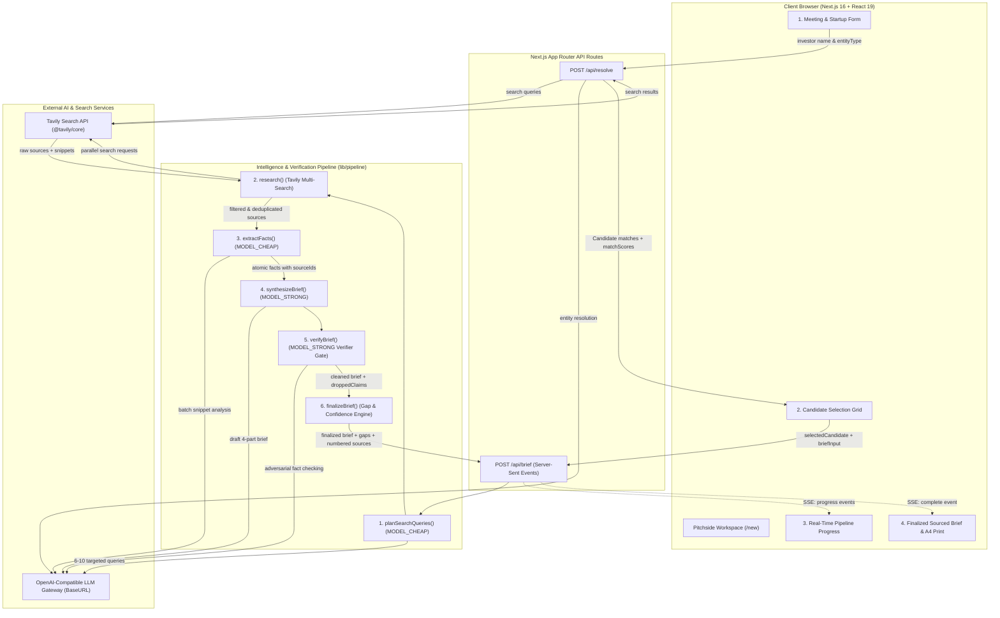

# Pitchside — Comprehensive Project Context & Landing Page UI/UX Audit
**Document Type:** Technical Architecture Audit, Product Intelligence & Redesign Context Brief  
**Target Audience:** Redesign Frontend Engineers, Product Designers & AI Design Agents  
**Project Name:** Pitchside (`pitchside FIELDNOTES`)  
**Hackathon:** Global AI Hackathon — Tavily Side Track  
**GitHub Repository:** `https://github.com/kritsii/globalai-tavily.git` (Branch: `main`, Commit: `f92d518`)  
**Live Production Deployment:** `https://globalai-tavily.vercel.app/`  
**Date of Audit:** November 13, 2026  
**Auditor:** Senior Software Architect, Product Designer & UI/UX Specialist  

---

## 1. Executive Summary

### 1.1 What Pitchside Is
**Pitchside** is an open-source, evidence-grounded investor meeting preparation tool designed for startup founders. Unlike conversational AI wrappers or generic research agents that produce flattering but ungrounded corporate summaries, Pitchside automates the creation of a dense, one-page, A4-printable investor briefing memo where **every single factual claim is tied to an explicit, dated, public web source retrieved via Tavily**.

The application operates on an uncompromising design and algorithmic premise: **Receipts Over Rhetoric**. If a claim cannot be verified against retrieved primary documents or reputable news within a strict date window, it is aggressively discarded by an automated verification gate. If vital information regarding an investor's fund size, current thesis, or portfolio overlap does not exist in the public record, Pitchside leaves the gap visibly and honestly labeled as *"Topic not found in sources searched"*, rather than allowing an LLM to hallucinate plausible filler.

### 1.2 Target Audience & Use Cases
- **Early-Stage Founders (Pre-Seed to Series A):** Founders scheduling partner meetings, intros, or pitches who have 15 minutes between build sprints to prepare for a partner call.
- **Repeat Entrepreneurs & Operators:** Teams that demand verified, recent (last 30 days) intelligence (partner departures, fund announcements, recent syndicate deals) rather than stale Wikipedia-style summaries.
- **Fundraising Advisors & Accelerators:** Mentors needing a consistent, verifiable standard for meeting preparation across batch companies.

### 1.3 Core Value Proposition
> *"Walk into investor meetings with research you can trace."*
>
> 1. **Zero Hallucination Tolerance:** Every bullet points to a numbered source chip `[1]`, `[2]` linking directly to an official domain or tier-1 news outlet.
> 2. **Recency-Enforced Intelligence:** Distinguishes between fresh signals from the last 30 days (launches, hires, investments) and older foundation facts (labeled *Background*).
> 3. **Honest Knowledge Gaps:** Unashamedly declares what is unknown rather than guessing.
> 4. **One-Page A4 Executive Print Format:** Formatted to fit on a physical printed sheet or single-page PDF to review immediately before entering the conference room or Zoom call.

### 1.4 The Hackathon Edge (Tavily Side Track)
Pitchside does not use Tavily as a simple search bar replacement. It leverages Tavily as an **autonomous research engine and verification anchor**:
- Dynamic multi-angle query decomposition across 6 discrete categories.
- Domain-locked deep search on investor root domains (`officialDomain`).
- Date-windowed parameter enforcement (`startDate`, `endDate`, `includePublishedDate: true`, `filterByPublishedDate: true`).
- Structured entity resolution (disambiguating partners vs. venture firms).
- Verifier gate that uses Tavily source snippets as ground truth to cross-examine synthesized claims.

---

## 2. Product Understanding

### 2.1 The Problem It Solves
1. **The Hallucination Trap of LLMs:** Standard LLMs (ChatGPT, Claude, Perplexity) frequently hallucinate partner portfolios, confuse fund stages, attribute deals made at previous firms to current firms, and fabricate alignment reasons to be helpful. Citing a fake portfolio company or wrong thesis to a VC partner instantly terminates founder credibility.
2. **The Diligence Time Sink:** Conducting manual research across Crunchbase, PitchBook, TechCrunch, Twitter/X, Substack, and investor blogs takes 45–90 minutes per investor.
3. **The Recency Blindspot:** VCs move rapidly. A partner who led AI investments might have left the firm two weeks ago, or the firm may have just deployed capital into a direct competitor yesterday. Without strict date-windowed intelligence, founders walk into traps.

### 2.2 The Solution
Pitchside structures the preparation process into a clean, deterministic pipeline:
1. **Context Capture:** Founder inputs investor name, meeting date/type, and startup parameters (sector, stage, raise size).
2. **Entity Resolution:** Tavily searches identify the exact organization or partner, verifying official web domains and returning match confidence scores.
3. **Targeted Search Planning:** Generates 6–10 search queries categorized into firm news, new investments, partner interviews, portfolio updates, thesis statements, and sector competitors.
4. **Recency-Filtered Extraction:** Executes search via Tavily, filtering out social media garbage and non-authoritative sources, enforcing a 30-day window for signals.
5. **Synthesized Brief Generation:** Groups evidence into four standard sections: *At a Glance*, *Last 30 Days*, *Fit with Your Startup*, and *Open Questions*.
6. **Adversarial Verification Gate:** A dedicated LLM verifier inspects every synthesized sentence against retrieved snippets. If a claim is unsupported, it is discarded into `droppedClaims`.
7. **Finalized 1-Page Memo:** Final brief is generated with clickable citation chips, confidence flags (*Confirmed* vs. *Single-source*), explicit gaps, and print-optimized formatting.

### 2.3 User Journey Walkthrough
```
[Landing Page] ──► [Create a brief (/new)]
                         │
                         ▼
             [Step 1: Context Form]
             - Investor Name & Type (Firm / Partner)
             - Meeting Date/Time & Type
             - Startup One-Liner, Sector, Stage, Raise Size
                         │
                         ▼
             [Step 2: Candidate Match (/api/resolve)]
             - Tavily searches for official presence
             - User selects verified candidate card (Domain + Score)
                         │
                         ▼
             [Step 3: Streaming Generation (/api/brief)]
             - SSE Stream: Plan ➔ Research ➔ Extract ➔ Synthesize ➔ Verify ➔ Finalize
             - Live progress indicator with source and fact counters
                         │
                         ▼
             [Step 4: Sourced Brief View (/new)]
             - Research Snapshot & Run Stats
             - 4-part Brief Document with [1][2] inline citations
             - "Print A4 brief" -> 1-page paper-ready layout
             - Stored in session Library for instant recall
```

### 2.4 Feature Status Matrix

| Feature | Status | Verification Reference | Notes |
| :--- | :---: | :--- | :--- |
| **Landing Page** | Implemented | `components/landing-page.tsx`, `app/page.tsx` | Functional but visually cluttered and generic |
| **Demo / Sample Preview** | Implemented | `components/demo-brief.tsx`, `app/demo/page.tsx` | Interactive Y Combinator mock brief with citations |
| **Candidate Resolution** | Implemented | `app/api/resolve/route.ts` | Disambiguates firm vs partner via Tavily |
| **Multi-Vector Search Plan** | Implemented | `lib/pipeline/plan.ts` | 6 strict query categories, quotes firm name |
| **Tavily Live Research** | Implemented | `lib/pipeline/research.ts`, `lib/tavily.ts` | Date gating (30-day window), domain matching |
| **Atomic Fact Extraction** | Implemented | `lib/pipeline/extract.ts` | Batch fact extraction citing source IDs |
| **Brief Synthesis** | Implemented | `lib/pipeline/synthesize.ts` | 4 sections, max word limits per bullet |
| **Adversarial Verifier** | Implemented | `lib/pipeline/verify.ts` | Drops unsupported or duplicated claims |
| **Gap Detection** | Implemented | `lib/pipeline/finalize.ts` | Flags missing search query categories |
| **Run Stats & Audit** | Implemented | `types/index.ts`, `lib/llm.ts` | Tracks tokens, latency, fallbacks, dropped claims |
| **Token Budget Limit** | Implemented | `app/api/brief/route.ts` | Enforces `BRIEF_BUDGET_MAX_TOKENS` guardrail |
| **A4 Print Engine** | Implemented | `app/globals.css` (lines 1566–1728) | High-precision CSS paged media for 1-page print |
| **Session Library** | Implemented | `components/pitchside-workspace.tsx` | In-memory session brief history |
| **Light/Dark Mode** | Implemented | `components/site-header.tsx`, `app/globals.css` | System default with localStorage override |
| **Persistent User Database** | Not Planned / None | N/A | By design: stateless, zero persistent data storage |
| **User Authentication** | Not Planned / None | N/A | By design: anonymous, frictionless workspace |

### 2.5 Most Impressive Functionality to Highlight
1. **The Adversarial Verifier Gate (`lib/pipeline/verify.ts`):** 
   Pitchside deliberately runs a secondary verification model step whose single job is to try to invalidate synthesized claims using only raw Tavily snippets. If a claim cannot be verified, it is discarded into `droppedClaims` (tracked in `RunStats`) rather than kept.
2. **Explicit Knowledge Gaps (`finalize.ts`):**
   Pitchside does not pretend to know everything. If search returns no valid signal for thesis statements or competitors, it outputs an explicit "Gaps and uncertain" section.
3. **The Print A4 1-Page Constraint:**
   Unlike endless dashboard web apps, the output is formatted via precise CSS paged media (`@page { size: A4 portrait; margin: 6mm; }`) into a physical or PDF field-memo.

---

## 3. Technical Architecture Audit

### 3.1 Technology Stack & Package Versions

```
Frontend:
├── Next.js 16.4.5 (App Router, Turbopack)
├── React 19.3.0 & React-DOM 19.3.0
├── TypeScript 5.x
├── Tailwind CSS v4 (@tailwindcss/turbopack ^4)
└── Fonts: Space Grotesk (Sans) & IBM Plex Mono (Mono) via next/font/google

Backend / API:
├── Next.js Route Handlers (Edge/Node compatible streaming)
├── Server-Sent Events (SSE) via ReadableStream Web API
├── @tavily/core (^1.0.0)
├── openai (^7.50.0) — configured with multi-model fallback & backoff
└── zod (^4.6.7) — strict schema contracts & runtime type validation

Infrastructure & Ops:
├── Hosting: Vercel (Production)
├── Storage: In-memory client state (zero persistence, ephemeral)
└── Authentication: None (public, anonymous)
```

### 3.2 End-to-End Architectural Data Flow



### 3.3 Complete File Path Map

```
/home/rahul/tavily
├── app/
│   ├── api/
│   │   ├── brief/
│   │   │   └── route.ts          # SSE Streaming brief generation pipeline
│   │   └── resolve/
│   │       └── route.ts          # Investor candidate entity resolution endpoint
│   ├── demo/
│   │   └── page.tsx              # Standalone sample brief preview page
│   ├── new/
│   │   └── page.tsx              # Main interactive 4-step brief workspace
│   ├── globals.css               # Design tokens, variables, typography, print styles
│   ├── layout.tsx                # Space Grotesk + IBM Plex Mono fonts setup
│   └── page.tsx                  # Root landing page (renders <LandingPage />)
├── components/
│   ├── brief-view.tsx            # Sourced brief document, citations, and run stats
│   ├── demo-brief.tsx            # Seeded YC illustrative brief component
│   ├── landing-page.tsx          # Current landing page structure
│   ├── pitchside-workspace.tsx   # State machine for Form -> Match -> SSE -> Brief
│   └── site-header.tsx           # Navigation, brand mark, and theme toggle
├── lib/
│   ├── pipeline/
│   │   ├── extract.ts            # Atomic fact extraction from Tavily snippets
│   │   ├── finalize.ts           # Numbered citations, gap analysis, confidence scoring
│   │   ├── plan.ts               # 6-category search query generator
│   │   ├── research.ts           # Tavily search orchestration, date gating, deduplication
│   │   ├── synthesize.ts         # Initial 4-section brief drafting
│   │   └── verify.ts             # Adversarial claim verifier gate
│   ├── llm.ts                    # OpenAI client, multi-tier fallback, token tracking
│   ├── source-quality.ts         # Blocklist filtering, date range calculations
│   └── tavily.ts                 # Tavily SDK client wrapper, cache, source normalization
├── types/
│   └── index.ts                  # Zod schemas & TypeScript types for all data models
├── .env.example                  # Environment configuration template
├── next.config.ts                # Next.js configuration
├── package.json                  # Dependencies and build scripts
└── tsconfig.json                 # TypeScript compiler options
```

### 3.4 Environment Variables Architecture
Pitchside requires the following environment variables (defined in `.env.example`):
- `TAVILY_API_KEY`: API key for `@tavily/core` search requests.
- `LLM_BASE_URL`: Base URL for OpenAI-compatible endpoint (allows using OpenAI, OpenRouter, Groq, Together, or local proxy).
- `LLM_API_KEY`: Authentication secret for the LLM provider.
- `MODEL_CHEAP`: Fast/economical model for query planning (`lib/pipeline/plan.ts`) and fact extraction (`lib/pipeline/extract.ts`).
- `MODEL_STRONG`: High-reasoning model for brief synthesis (`lib/pipeline/synthesize.ts`) and verifier gate checks (`lib/pipeline/verify.ts`).
- `MODEL_FALLBACK`: Automatic fallback model if the primary model fails or encounters rate limits.
- `BRIEF_BUDGET_MAX_TOKENS`: Hard positive-integer token ceiling per brief generation (enforced in `app/api/brief/route.ts`).

---

## 4. Deep Tavily API Integration Audit

### 4.1 How Tavily Is Used Across the Codebase
Tavily is integrated at two critical touchpoints:

#### A. Candidate Entity Resolution (`app/api/resolve/route.ts`)
When a founder enters an investor name (e.g., "Benchmark" or "Peter Fenton"):
1. The endpoint runs two targeted searches:
   - For a **firm**: `"<investor>" official website` and `"<investor>" firm partners leadership`.
   - For a **person**: `"<investor>" investor partner official profile` and `"<investor>" venture capital firm partner`.
2. Gathers up to 16 search results, normalizes domains, and passes snippets to `MODEL_CHEAP`.
3. The LLM extracts up to 3 candidate entities with:
   - `type`: "firm" | "partner" | "other"
   - `name`: Clean verified entity name
   - `officialDomain`: Root domain (e.g., `benchmark.com`)
   - `descriptor`: Concise identity summary
   - `matchScore`: Numerical confidence (0.0 to 1.0)
   - `evidenceUrls`: Exact URLs proving the domain and relationship.
4. The server validates that candidate `officialDomain` actually matches the host in `evidenceUrls` before returning candidates to the client.

#### B. Deep Pipeline Research (`lib/pipeline/research.ts` & `lib/tavily.ts`)
The research pipeline executes between 6 and 10 parallel search queries planned across 6 essential categories:
1. `firm_news`: Recent announcements, partner additions, leadership changes.
2. `new_investments`: Recent syndicate deals, lead rounds, batch announcements.
3. `partner_posts_interviews`: Podcasts, interviews, Substack posts, op-eds.
4. `portfolio_news`: Updates on existing portfolio companies.
5. `thesis_statements`: Published focus areas, Requests for Startups, investment stage guidelines.
6. `sector_competitors`: Other companies operating in the founder's sector.

### 4.2 Exact Tavily Query Parameters Used
Implemented in `lib/tavily.ts`:
```typescript
const client = tavily({ apiKey });
const filterByDate = !includeDomains?.length;
const searchOptions = {
  maxResults: 8,
  ...(filterByDate ? { startDate, endDate } : {}),
  includePublishedDate: true,
  filterByPublishedDate: filterByDate,
  timeout: 30,
  ...(includeDomains?.length ? { includeDomains } : {}),
  ...(topic ? { topic } : {}),
};
const response = await client.search(normalizedQuery, searchOptions);
```

### 4.3 Data Hygiene & Anti-Noise Filtering
1. **Blocklist Rejection:** `lib/source-quality.ts` filters out unverified social media: `instagram.com`, `facebook.com`, `tiktok.com`, `youtube.com`, `pinterest.com`, `reddit.com`, `quora.com`. At most one blocklisted source is allowed across the entire brief, and it is strictly banned from supporting *Recent Signals*.
2. **Date-Window Enforcement:** 
   - Uses `startDate` (meeting date minus 30 days) and `endDate` (meeting date).
   - Any source published outside the 30-day window is discarded, **unless** it originates directly from the candidate's `officialDomain` (e.g. standard fund terms, YC standard deal, published RFS), in which case it is flagged as `background: true`.
3. **Relevance Filtering:** 
   - A source must either originate from the official domain or mention the exact investor/firm name matching a Unicode word-boundary regex (`mentionsFirm`).
4. **Source Classification:**
   - `primary`: Root investor domain, `/blog`, `/newsroom`, `/press`, `/investor-relations`.
   - `news`: Reputable publishers (`apnews.com`, `axios.com`, `bloomberg.com`, `ft.com`, `reuters.com`, `techcrunch.com`, `wsj.com`, etc.).
   - `aggregator`: General web pages.
   - Sorter prioritizes Primary > News > Aggregator > Publication Recency. Top 12 sources are assigned identifiers `S1` through `S12`.

---

## 5. Live Website vs. Codebase Audit

### 5.1 Verification of Live Deployment
The live URL `https://globalai-tavily.vercel.app/` was directly tested via headless browser sessions across multiple viewports (Desktop 1440px, Tablet 768px, Mobile 375px) and dark mode.

**Confirmed Findings:**
- The deployed website reflects commit `f92d518` ("add demo seed").
- All client-side routing (`/`, `/demo`, `/new`) is active and functional.
- The visual styling matches `app/globals.css` exactly.
- Light/Dark theme toggling works reliably, with styles switching immediately and persisting in `localStorage`.

### 5.2 Browser Observations by Viewport

#### Desktop (1440px Viewport)

- **Header:** Sticky header with `pitchside FIELDNOTES` logo, links to "Sample brief", "New brief", and theme toggle. Clean alignment, but sparse.
- **Hero Section:** Left column contains eyebrow, main headline ("Walk into investor meetings with research you can trace"), subhead, primary CTA ("Create a brief ->"), secondary CTA ("See a sample brief"), and a small note ("No unsupported claims presented as fact."). Right column contains two concentric dashed circles (orbits) and a small card tilted at `-3deg` reading "Know what to ask. Know where it came from."
- **Sample Brief Section:** A huge white box (`sample-brief`) on cream background. Contains the full Y Combinator mock brief with citations `[1]`, `[2]`. Underneath is a small text link "Explore the sample brief ->".
- **How It Works Section:** 4 small bordered cards numbered `01` to `04` in a 4-column horizontal grid.
- **Why You Can Trust It Section:** 3 columns with unicode symbols (`↗`, `✓`, `○`) and text.
- **Footer:** Brand logo, "Search by Tavily" badge with a green pulsing dot, and disclaimer text.

#### Tablet (768px Viewport)

- The hero layout stacks vertically: the text copy comes first, followed by the orbit circles and tilted card.
- "How it works" shifts from 4 columns to a 2x2 grid.
- The sample brief card remains wide and readable, but the overall vertical scroll length increases dramatically.

#### Mobile (375px Viewport)

- **Header:** Nav links ("Sample brief") disappear; only "New brief" and theme toggle remain.
- **Hero:** Buttons become full-width stacked blocks. The orbit and tilted card sit underneath the buttons, consuming 320px of height without conveying real product utility.
- **Sample Brief Card:** Becomes an exceptionally tall scroll (over 1,600 vertical pixels). Small font sizes in the citation boxes (`sample-brief__sources`) wrap tightly.
- **Footer:** Items stack cleanly.

#### Dark Mode Appearance

- Background shifts to deep forest-tinted charcoal (`#0c1511`), surfaces to `#111d17`, text to `#e7eee8`, and accents to ice blue (`#80c4ff`).
- The dark mode palette is distinct and appealing, but borders (`--border: #2a3a30`) have low contrast against background surfaces, making section boundaries somewhat indistinct.

---

## 6. Ruthless UI/UX Audit & Critical Findings

The current landing page functions as a minimal MVP, but it **fails to look premium, distinctive, or compelling**. It currently looks like a developer wireframe with warm colors.

### 6.1 Visual Design Deficiencies

| Issue | Severity | Observation | Affected Component |
| :--- | :---: | :--- | :--- |
| **Gimmicky "Orbit" Visual** | **HIGH** | The right-side hero graphic consists of two thin dashed CSS circle borders and a small tilted card (`rotate(-3deg)`). It looks like a mock-up placeholder from 2021. It communicates zero product information and does not look like software. | `.landing-hero__visual`, `.hero-orbit`, `.hero-note-card` |
| **Text-Wall Sample Dump** | **HIGH** | The sample brief is dumped directly onto the page in its entirety as a flat white box. It is dense, difficult to scan, and forces visitors to read paragraphs of static YC text before understanding how the tool works. | `.sample-section`, `.sample-brief` |
| **Redundant Navigation Flow** | **MEDIUM** | The landing page embeds the sample brief in full, but also provides two prominent CTAs to `/demo` ("See a sample brief" and "Explore the sample brief ->"). When clicked, `/demo` literally renders the exact same sample brief on a nearly empty page. This is confusing and redundant. | `.landing-actions`, `components/demo-brief.tsx` |
| **Weak Visual Hierarchy & Contrast** | **MEDIUM** | In light mode, `--surface` (`#fbf9f4`) and `--background` (`#f3efe6`) are too similar in luminance. Cards feel flat and lack depth, elevation, or crisp definition. | `app/globals.css`, `.panel`, `.how-card` |
| **Buried Superpower** | **HIGH** | The most impressive engineering in this project—the **adversarial verifier gate that actively drops fake claims**—is described in two dry sentences ("Verifier checks: Unsupported claims are dropped instead of being polished into certainty"). There is no visual demonstration of this differentiator! | `.trust-section`, `.how-section` |
| **Lack of Live Product Teaser** | **MEDIUM** | The visitor never sees the actual app interface (the 4-step wizard, the match cards, the SSE stream) until they click into `/new`. | Hero composition |
| **Generic Feature Cards** | **MEDIUM** | The "How it works" and "Why you can trust it" sections use standard, uninspired 4-column and 3-column card grids with plain text and unicode arrows (`↗`, `✓`, `○`). | `.how-grid`, `.trust-grid` |
| **Missing Social/Technical Credibility** | **LOW** | No explanation of why Tavily was chosen over standard Google/Bing scraping (i.e. LLM-optimized search, clean markdown snippets, structured published dates). | Footer & Trust section |

---

## 7. Strategic Product Positioning & Ten-Second Rule

### 7.1 What Visitors Must Understand, Feel, and Do in 10 Seconds

```
UNDERSTAND (First 3 Seconds)
"This is an automated intelligence briefing tool for investor meetings that cites 
every single fact and refuses to hallucinate."

FEEL (Next 4 Seconds)
"This feels like an elite, high-precision intelligence briefing compiled by an analyst—
clean, authoritative, transparent, and completely trustworthy."

DO (By Second 10)
Click "Create your brief" or test an interactive sample right in the hero viewport.
```

### 7.2 Ideal Positioning & Headline Direction
- **Weak Existing Headline:** *"Walk into investor meetings with research you can trace."* (A bit wordy, passive).
- **Strong Strategic Positioning Options:**
  - *Option 1 (Precision / Intelligence Focus):*  
    **"The Investor Brief That Never Lies."**  
    *Subhead:* Live public diligence on any VC firm or partner in 60 seconds. Every claim linked to live sources. Zero hallucinations.
  - *Option 2 (Outcome / Founder Confidence Focus):*  
    **"Never Get Blinded in a Partner Meeting."**  
    *Subhead:* Verified recent signals, thesis alignment, and sharp questions for your upcoming pitch—backed by verifiable Tavily web research.
  - *Option 3 (High-Craft / Anti-AI Tooling Focus):*  
    **"Receipts Over Rhetoric. Investor Diligence for Founders."**  
    *Subhead:* Automated meeting briefs with verifiable source trails, strict 30-day signal windows, and an automated verifier that drops unsupported claims.

### 7.3 Strongest Real Product Capability to Showcase
The **Side-by-Side "Verifier in Action" Proof**:
Show a real sentence comparison:
- ❌ **Generic AI Output:** *"Sequoia is actively deploying their new $900M fund into climate-tech robotics startups across Europe and loves early-stage SAFE notes."* (Sounds convincing, completely fabricated).
- ✅ **Pitchside Verified Output:** *"YC standard deal is $500K: $125K on a post-money SAFE + $375K MFN `[1]`. Focus includes physical AI buildouts `[2]`. (Dropped claim: $900B hotel investment — unsupported by retrieved sources)."*

---

## 8. Recommended Landing Page Structure (Blueprint for Redesign)

A modern, high-converting, premium landing page should follow this intentional narrative flow:

```
┌─────────────────────────────────────────────────────────────────┐
│ 1. MINIMAL STICKY HEADER                                        │
│    Brand mark + "FIELDNOTES" tag + Tavily Engine badge + CTA   │
├─────────────────────────────────────────────────────────────────┤
│ 2. HERO: VALUE PROPOSITION & LIVE INTERACTIVE BRIEF TEASER      │
│    Left: Bold positioning, crisp subhead, single primary CTA    │
│    Right: Interactive "Anatomy of a Verified Brief" card        │
│           (Hoverable citation chips showing source popovers)    │
├─────────────────────────────────────────────────────────────────┤
│ 3. THE RISK WE SOLVE: "THE COST OF AN AI HALLUCINATION"         │
│    A stark visual comparison: Hallucinated AI vs. Pitchside     │
│    (Highlights the adversarial verification gate)               │
├─────────────────────────────────────────────────────────────────┤
│ 4. THE 4 PILLARS OF A PITCHSIDE BRIEF (Interactive Tabs)        │
│    - At a Glance (Official foundation facts)                    │
│    - Last 30 Days (Strict 30-day recency window)                │
│    - Fit with Your Startup (Honest evidence comparison)         │
│    - Open Questions & Knowledge Gaps (Unashamedly visible)      │
├─────────────────────────────────────────────────────────────────┤
│ 5. HOW IT WORKS: THE 5-STAGE TAVILY PIPELINE                    │
│    Step 1: Disambiguation & Entity Match                        │
│    Step 2: 6-Category Query Matrix                              │
│    Step 3: Tavily Live Gated Search                             │
│    Step 4: Atomic Fact Extraction                               │
│    Step 5: Verifier Check & One-Page Print Generation           │
├─────────────────────────────────────────────────────────────────┤
│ 6. THE ONE-PAGE MEMO PHILOSOPHY (The A4 Standard)               │
│    Visual showcase of the print-optimized physical memo layout   │
├─────────────────────────────────────────────────────────────────┤
│ 7. FINAL INVITATION & TECHNICAL CREDIBILITY FOOTER              │
│    Clean CTA to start brief + Tavily architecture acknowledgement│
└─────────────────────────────────────────────────────────────────┘
```

### Content Strategy: Retain, Remove, and Rewrite

| Action | Content Item | Rationale |
| :--- | :--- | :--- |
| **REMOVE** | CSS Orbit Circles & Tilted Card Graphic | Pure visual fluff that looks amateurish and uninformative. |
| **REMOVE** | Standalone `/demo` page link | Redundant. Bring the interactive demo directly into the landing page flow. |
| **REMOVE** | Redundant "See a sample brief" secondary button | Dilutes the single primary conversion path (`/new`). |
| **RETAIN** | Seeded Y Combinator brief data points | High brand recognition, authentic SAFE deal numbers, genuine RFS references. |
| **RETAIN** | "PITCHSIDE / FIELD NOTES" archival aesthetic | Gives an aura of an investigative intelligence dossier. |
| **REWRITE** | Hero Subhead | Make it tighter, crisper, and focused on founder leverage in the meeting room. |
| **REWRITE** | "How it works" descriptions | Replace vague text with the actual Tavily pipeline mechanics (Resolving -> Querying -> Verifying). |
| **ADD** | Interactive Citation Popover | Let visitors hover/click on citation chips `[1]` to see the actual snippet and Tavily source URL. |
| **ADD** | "Dropped Claim" Verifier Demo | Visually display a red strike-through of an unsupported claim being pruned by the verifier. |

---

## 9. Three Distinct Visual Directions

### Direction 1: The Investigative Dossier (Editorial Minimalism)
- **Concept:** Inspired by *Financial Times*, *The Economist*, and boutique investigative research firms. Treats investor prep like a high-stakes intelligence dossier.
- **Palette:** Warm archival paper background (`#F4EFEA`), deep charcoal-ink typography (`#1A1C1E`), crisp hairline borders (`#DDD5CC`), and a restrained British racing green or burnt amber accent (`#2D5A43`).
- **Typography:** Serif or architectural grotesque for display headers (e.g. *Newsreader* or *Space Grotesk*), paired with strict monospace (*IBM Plex Mono*) for all citations, dates, and metadata.
- **Visual Texture:** Crisp 1px rules, tabular data alignment, zero box shadows, authentic print registration marks, document kicker stamps ("FIELDNOTES // VERIFIED").
- **Best For:** Communicating absolute intellectual seriousness, rigorous research, and white-collar diligence.

### Direction 2: The Precision Diligence Terminal (Modern High-Craft Tool)
- **Concept:** Inspired by *Linear*, *Vercel*, and *Raycast*. Focuses on high-velocity software craftsmanship and engineering precision.
- **Palette:** Dark mode native: Deep rich obsidian (`#0D1117`), graphite surface cards (`#161B22`), luminous ice-blue accent (`#58A6FF`), and Tavily emerald status dots (`#2EA043`).
- **Typography:** Highly tuned grotesque sans (`Space Grotesk` or `Inter`) with monospaced execution telemetry (`IBM Plex Mono`).
- **Visual Texture:** Subtle 1px borders with delicate hover luminescence, interactive keyboard badges, live pulsing SSE pipeline telemetry, modular micro-panels.
- **Best For:** Modern tech founders who appreciate developer-grade craft, speed, and real-time streaming feedback.

### Direction 3: The Archival Field Notebook (Tactile Technical Workspace)
- **Concept:** Inspired by field journals, Dieter Rams industrial design, and technical engineering notebooks.
- **Palette:** Technical drafting parchment (`#EFECE6`), warm matte slate (`#26282B`), drafting blueprint blue (`#1879D1`), and muted canary warning tags (`#E5A93C`).
- **Typography:** Tight, geometric technical sans paired with typewriter-precise monospace tables.
- **Visual Texture:** Ruled grids, numbered margin callouts, physical tabbed dividers, stamped verification tags, and clear paper-cutout card elevations.
- **Best For:** Creating a memorable, highly distinctive brand that stands completely apart from 99% of generic SaaS websites.

---

## 10. Existing Component Reusability & Modification Guide

```
components/
├── landing-page.tsx
│   └── RECOMMENDATION: REWRITE FROM SCRATCH
│       The current layout contains the outdated hero visual, text-heavy brief dump,
│       and generic card grids. Replace with the narrative structure detailed in Section 8.
│
├── site-header.tsx
│   └── RECOMMENDATION: REUSE & REFINE
│       Keep brand mark, theme toggle, and sticky blur header. Simplify navigation by
│       removing the redundant "/demo" link and ensuring high-contrast CTA styling.
│
├── demo-brief.tsx
│   └── RECOMMENDATION: REPURPOSE AS INTERACTIVE WIDGET
│       Extract the seeded YC data and convert it into an interactive mini-component with
│       clickable popovers for citations, rather than an unstyled full-page text block.
│
├── brief-view.tsx
│   └── RECOMMENDATION: KEEP UNTOUCHED (App Workspace)
│       This component powers the core output screen after generation. It has perfectly
│       tuned A4 print styles and citation lookups. Do not alter its internal structure.
│
└── pitchside-workspace.tsx
    └── RECOMMENDATION: KEEP UNTOUCHED (App Workspace)
        Manages the 4-step state machine (New Brief -> Candidate Matches -> SSE Stream -> Library).
        The redesign should route directly into `/new` without breaking this workflow.
```

---

## 11. Responsive, Accessibility & Performance Considerations

### 11.1 Responsive Guidelines
- **Desktop (1200px+):** Hero should feature a clean two-column split: left-aligned value prop and right-aligned interactive brief preview with live hover citation states.
- **Tablet (768px - 1024px):** Ensure the interactive brief widget scales down without horizontal clipping. Citations should support tap-to-toggle popovers instead of relying on desktop hover.
- **Mobile (< 640px):** 
  - Stack hero elements cleanly.
  - Buttons must be full-width touch targets (minimum 44px height).
  - Instead of scrolling through 2,000px of sample brief text, present an interactive tabbed accordion (e.g. [At a glance] | [Last 30 days] | [Startup fit] | [Open questions]).
  - Ensure sticky header padding does not encroach on small viewport heights.

### 11.2 Accessibility Checklist
- **Color Contrast:** Verify all text on warm background (`#f3efe6`) meets WCAG AA (minimum 4.5:1 for body copy).
- **Interactive Tags:** Ensure all citation chips `[1]`, `[2]` are keyboard-focusable with visible focus rings (`:focus-visible`).
- **Semantic Structure:** Maintain single `<h1>` on the page, followed by logical `<h2>` section landmarks and `<article>` tags for briefs.
- **Reduced Motion:** Wrap all hover transitions and potential animations in `@media (prefers-reduced-motion: reduce)`.

### 11.3 Performance Discipline
- Zero external font stylesheets; continue leveraging `next/font/google` with local font variables (`--font-space-grotesk`, `--font-ibm-plex-mono`).
- Handcrafted inline SVGs only; avoid introducing large icon packages (e.g. `lucide-react`) to keep bundle size lightweight.
- Zero client-side heavy animation runtimes (avoid dragging in `framer-motion` unless strictly necessary; use lightweight Tailwind CSS transitions).

---

## 12. Design Constraints & Application Invariants

To ensure the redesign integrates seamlessly without breaking any backend or workspace functionality, the following rules **must be respected**:

1. **Do Not Touch Core Pipeline Code:** 
   - `lib/pipeline/*`, `lib/tavily.ts`, `lib/llm.ts`, `lib/source-quality.ts`, and `types/index.ts` are hardened, tested, and working. They must remain read-only.
2. **Preserve Application Entry Routes:**
   - Primary user workflow begins at `/new` (`app/new/page.tsx`).
   - All primary landing page CTAs must route to `/new`.
3. **Preserve Theme Variables:**
   - Keep `--background`, `--surface`, `--foreground`, `--accent`, `--border` CSS variable naming in `app/globals.css` so that the `/new` workspace and dark-mode toggle continue functioning seamlessly.
4. **Preserve Print Styles:**
   - The `@media print` rules in `app/globals.css` are critical for the 1-page A4 print feature. Do not delete or overwrite these rules during any CSS consolidation.
5. **No Database Dependencies:**
   - The product must remain 100% stateless and anonymous. Do not introduce user accounts, database schemas, or cloud persistence.

---

## 13. Open Questions & Unverified Assumptions

1. **Production Token Limits:** What is the exact value set for `BRIEF_BUDGET_MAX_TOKENS` in the Vercel production deployment? (Locally defaults to any integer, typically ~15,000–25,000 tokens).
2. **LLM Provider in Production:** Which underlying model is powering `MODEL_STRONG` and `MODEL_CHEAP` in production (e.g., GPT-4o / GPT-4o-mini, Claude 3.5 Sonnet, or Groq Llama 3.3)?
3. **Custom Domain:** Will the project remain at `https://globalai-tavily.vercel.app/` for the hackathon judging, or will a custom domain (e.g., `pitchside.ai`) be attached?

---

## 14. Final Handoff Brief (Instructions for the Redesign Assistant)

> ### 🎯 Mandate for the Redesign AI Assistant:
>
> You are tasked with creating a **completely new, world-class landing page** for **Pitchside** (`components/landing-page.tsx`).
>
> **Core Identity:** Pitchside is an evidence-first investor briefing tool for founders participating in the Global AI Hackathon (Tavily Side Track).
>
> **Design Tone:** High-craft, editorial, precision-engineered, trustworthy. Avoid generic AI SaaS cliches (no purple gradients, no floating shiny glass spheres, no fake testimonials, no generic buzzwords).
>
> **Key Sections to Build:**
> 1. **High-Impact Hero:** Punchy headline, crisp subhead, single clear CTA to `/new`, and an interactive visual showing a real verified brief snippet with hoverable citation chips.
> 2. **The "Hallucination vs. Receipts" Contrast:** A bold demonstration showing why generic AI fails founders and how Pitchside's verifier gate actively drops unverified claims.
> 3. **Interactive Brief Anatomy:** Showcase the 4 sections of the memo (*At a glance*, *Last 30 days*, *Fit verdict*, *Open questions*) with live source links.
> 4. **The Tavily Search Architecture:** Showcase how Tavily powers the 5-stage pipeline (entity resolution, 30-day date gating, official domain filtering, fact extraction, and honest gap surfacing).
> 5. **The A4 Print Standard:** Emphasize that Pitchside outputs a dense, printable 1-page field memo ready for the meeting table.
> 6. **Refined Header & Footer:** Sleek brand presence, theme toggle support, and "Search by Tavily" badge.
>
> **Technical Requirements:**
> - Keep implementation self-contained within `components/landing-page.tsx` and accompanying classes in `app/globals.css`.
> - Maintain light & dark theme compatibility using existing CSS variables.
> - Ensure 100% responsiveness on mobile, tablet, and desktop.
> - Link the primary CTA directly to `/new`.

