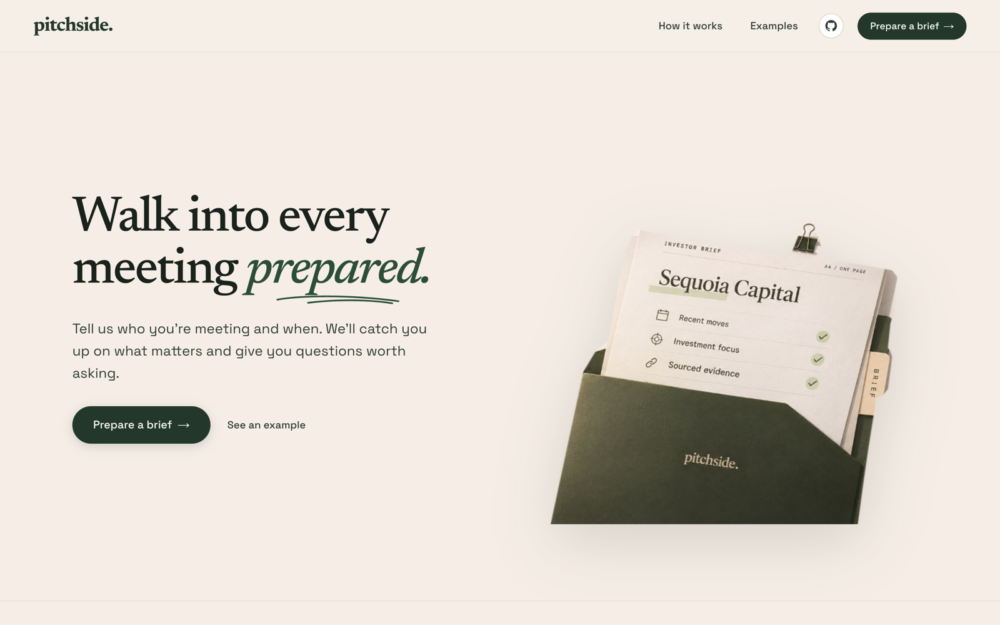
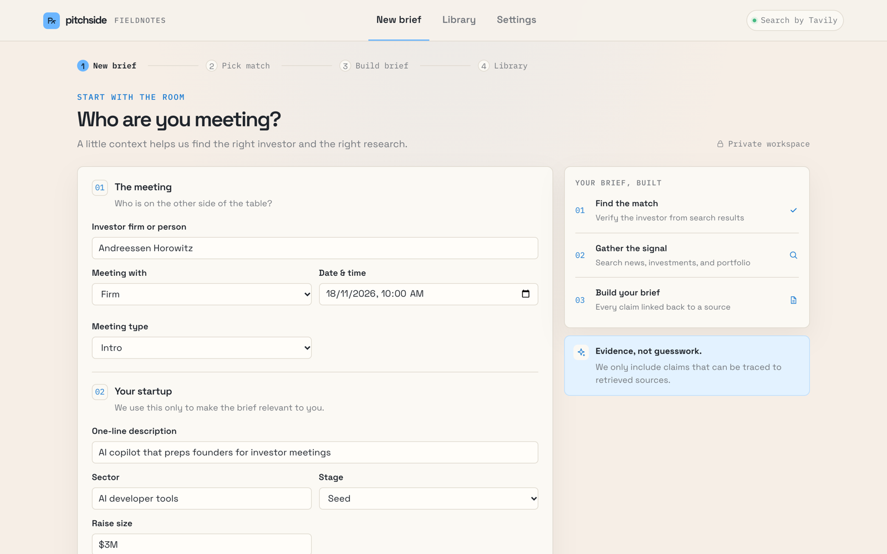
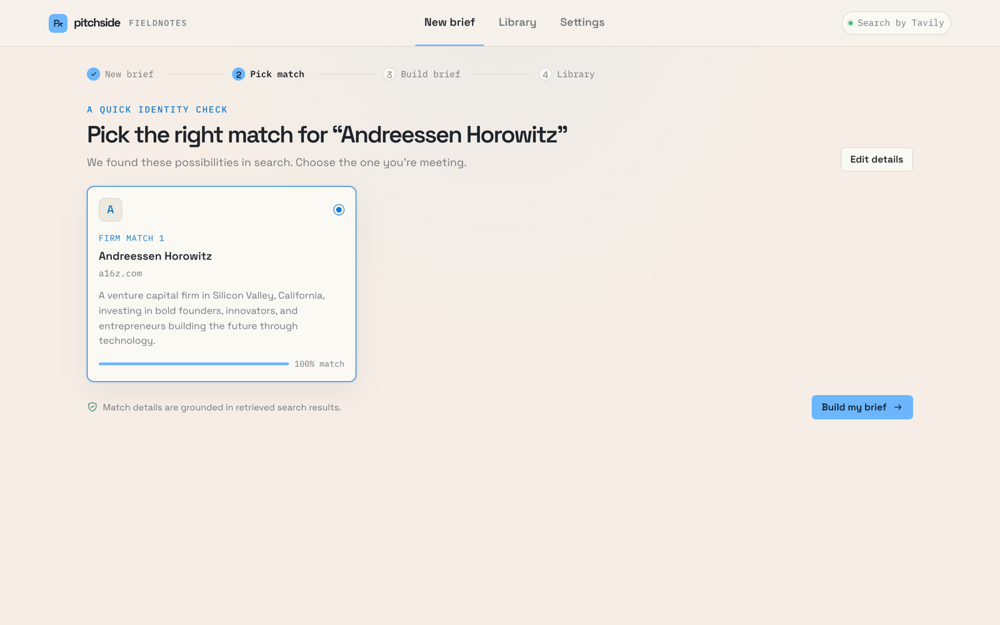
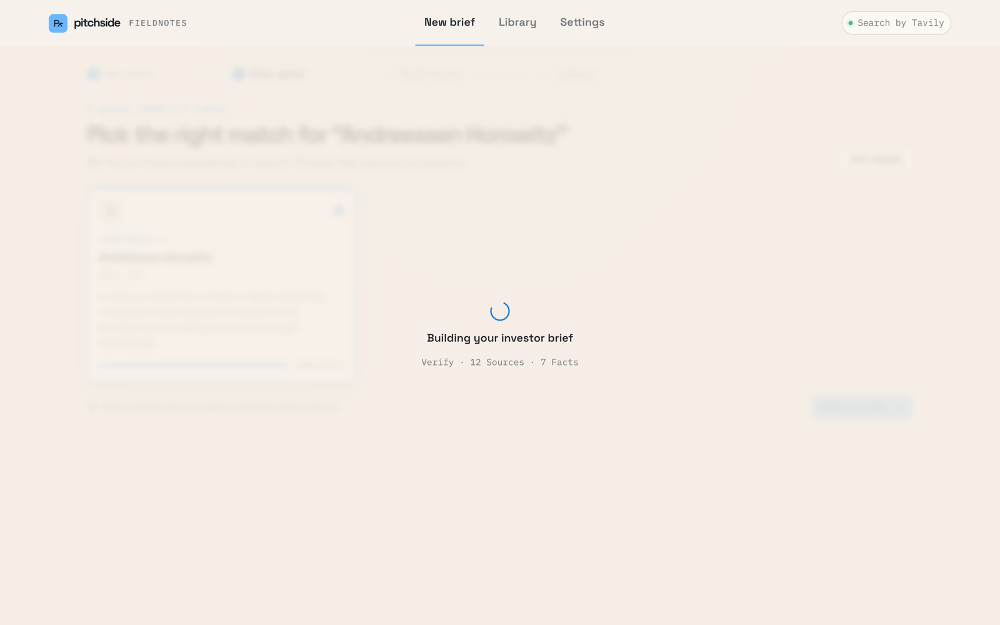
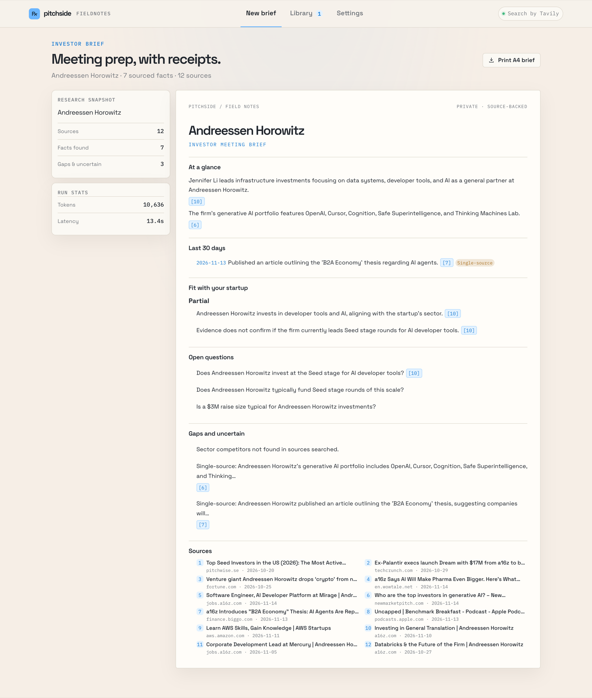
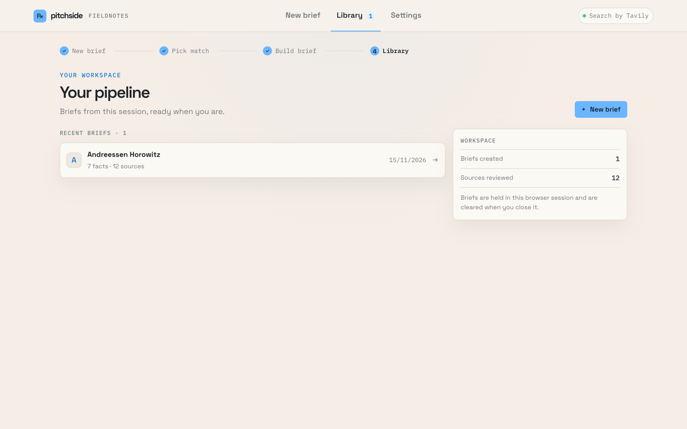
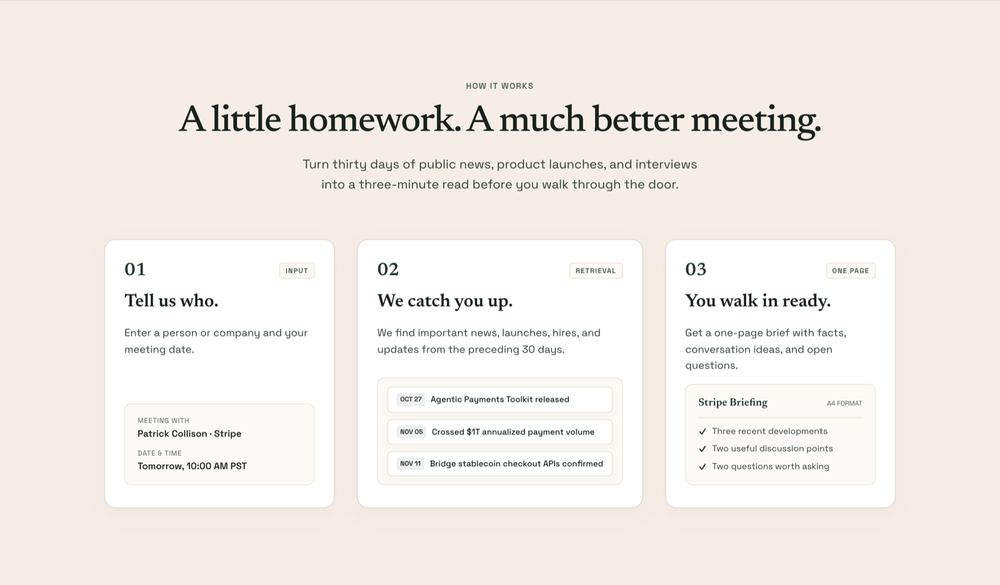
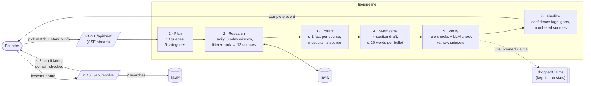

<div align="center">

# pitchside.

### Walk into every investor meeting prepared, with receipts.

**Pitchside turns the last 30 days of public web activity about an investor into a one-page meeting brief.<br/>Every claim links to a dated source. If something can't be backed up, it's dropped.**

[**▶ Watch the demo video (1:24)**](https://drive.google.com/file/d/1KJ6ggcx2DZxZhiyYbJsvWDg1_yegFD_q/view?usp=sharing) &nbsp;·&nbsp; [**Try it live →**](https://globalai-tavily.vercel.app/) &nbsp;·&nbsp; [How it works](#-how-it-works) &nbsp;·&nbsp; [How we use Tavily](#-how-we-use-tavily) &nbsp;·&nbsp; [Run it locally](#-run-it-locally)


<sub>Built for the <b>Global AI Hackathon, Tavily side track</b>.</sub>

<br/>



</div>

---

## 📌 Pitchside in 30 seconds

You have a meeting with an investor tomorrow. You need to know **what they've been doing lately**, **whether they back companies like yours**, and **what to ask them**.

Today you'd spend an hour across Google, Crunchbase, TechCrunch and their blog. Or you'd ask a chatbot, which might confidently invent a portfolio company or a fund size. **Saying something made-up to a partner is the fastest way to lose the room.**

Pitchside fixes this:

1. **You type** the investor's name, the meeting date and three facts about your startup.
2. **Pitchside searches the live web with Tavily**, checks you've got the right investor, and gathers recent, dated sources.
3. **You get a one-page brief** where every sentence has a numbered citation. A separate verification step **removes any claim the sources don't support**, and a **"Gaps" section says plainly what it couldn't find**.

> **Our rule: receipts over rhetoric.** If there's no source, it isn't in the brief.

---

## ✨ What makes it different

| | Generic AI chat | **Pitchside** |
|---|---|---|
| **Where facts come from** | Model memory, which can be months out of date | **Live Tavily search** at the moment you ask |
| **How fresh** | Unknown | **Hard 30-day window** ending on your meeting date |
| **Citations** | Optional, often invented | **Required on every sentence**, numbered `[1]` `[2]` and linked |
| **Made-up claims** | Kept, phrased with confidence | **Checked against source snippets and dropped** if unsupported |
| **Missing information** | Filled with plausible text | **Listed under "Gaps"**, e.g. *"Portfolio news not found in sources searched."* |
| **Confidence** | Everything sounds equally sure | Each fact tagged **Verified** (2+ domains) or **Single-source** |
| **Output** | A wall of chat text | **One-page brief you can print on A4** and take into the room |

---

## 🖼 See it in action

These screenshots come from a **real run** (15 Nov 2026, using Gemini 3.5 Flash-Lite), preparing for a seed-stage meeting with Andreessen Horowitz. None of the data is mocked.

### Step 1: Tell us who you're meeting

Enter the investor (a firm or a person), the meeting date and type, and a few details about your startup. The startup details are used **only** to tailor the brief: the fit section and open questions are written around your sector, stage and raise size.



### Step 2: Confirm the right investor

Names are ambiguous ("Accel", "Index" or a partner who shares a name with someone else). Pitchside runs Tavily searches, asks the model for at most three candidates, and **keeps a candidate only if its official domain appears in the search results it cites**. You pick the one you're actually meeting.



### Step 3: Watch the brief being built

The brief streams in live (Server-Sent Events) through six stages: **Plan → Research → Extract → Synthesize → Verify → Finalize**, with counts of sources and facts as they come in.



### Step 4: Read your sourced brief



How to read it:

| Section | What it tells you | Rules it follows |
|---|---|---|
| **At a glance** | Who they are, in two lines | Older facts allowed **only** if they come from the investor's own website (shown as *Background*) |
| **Last 30 days** | What they've done recently: deals, hires, launches, theses | Every item is **dated** and must cite a source from the 30-day window |
| **Fit with your startup** | Strong / Partial / Weak / **Not enough evidence** | Compares only your sector, stage and raise to sourced evidence. May cite the investor's own published thesis even if it's older (tagged *Background*). Says "not enough evidence" rather than guessing |
| **Open questions** | Three questions worth asking in the meeting | Each one is tied to a cited fact or to your startup details |
| **Gaps and uncertain** | What Pitchside **couldn't** find, and single-source facts | Generated automatically for every research topic that came back empty |
| **Sources** | The numbered list behind every `[n]` | Domain + publish date for every source |

Click **Print A4 brief** to get a clean one-page version for the meeting table.

### Your library

Every brief from the session is kept in a library. Nothing is saved on a server: briefs live in your browser session and disappear when you close it.



<details>
<summary><b>📱 Works on mobile too</b></summary>
<br/>

</details>

---

## ⚙️ How it works



Behind the three friendly steps is a **six-stage pipeline**. Each stage has a single job, and each one's output is validated with a Zod schema before the next one runs.



| # | Stage | File | What happens | Model |
|---|---|---|---|---|
| 1 | **Plan** | [`lib/pipeline/plan.ts`](lib/pipeline/plan.ts) | The LLM writes one tailored query for each of 6 categories: *firm news, new investments, partner posts & interviews, portfolio news, thesis statements, sector competitors*. Code then adds 4 hand-built queries (a news-only query, a query **locked to the investor's own domain**, and others). The investor's name is always in quotes. | `MODEL_CHEAP` |
| 2 | **Research** | [`lib/pipeline/research.ts`](lib/pipeline/research.ts) | All 10 queries run **in parallel** on Tavily. Results are de-duplicated by URL, filtered by date and relevance, ranked, and cut to the **top 12**, labelled `S1`…`S12`. Two of the 12 slots are reserved for the investor's own thesis pages, so they aren't pushed out by newer news. | n/a (Tavily) |
| 3 | **Extract** | [`lib/pipeline/extract.ts`](lib/pipeline/extract.ts) | Sources go to the LLM in batches of 4. It may pull **at most one fact per source, from the snippet only**, preferring the facts that matter for a meeting: focus, stage, check size, recent deals and hires. A fact citing a source outside its batch is discarded. | `MODEL_CHEAP` |
| 4 | **Synthesize** | [`lib/pipeline/synthesize.ts`](lib/pipeline/synthesize.ts) | The stronger model writes the four sections, citing fact IDs. A schema rejects any citation to a fact that doesn't exist. Code re-checks that every "Last 30 days" item is actually in the window. | `MODEL_STRONG` |
| 5 | **Verify** | [`lib/pipeline/verify.ts`](lib/pipeline/verify.ts) | Every sentence is checked twice. **Rule checks** first (are the cited sources real, dated and in the window? see below). Then the **LLM verifier** reads only the cited snippets (plus your startup fields, for Fit reasons) and marks the sentence *supported*, *partial* or *unsupported*. Unsupported sentences, and facts repeated across the two summary sections, are dropped and logged. | `MODEL_STRONG` |
| 6 | **Finalize** | [`lib/pipeline/finalize.ts`](lib/pipeline/finalize.ts) | Tags each fact **Verified** (backed by 2+ different domains) or **Single-source**, creates a **gap** for every research topic with no supported fact, numbers the sources, and adds a **staleness warning** if nothing was published in the 7 days before the meeting. No LLM is involved. | none |

---

## 🔎 How we use Tavily

Tavily isn't a search box bolted onto a chatbot here. **It is the only source of facts in the system.** The LLMs only rewrite and check what Tavily returned. All Tavily calls go through [`lib/tavily.ts`](lib/tavily.ts) and [`app/api/resolve/route.ts`](app/api/resolve/route.ts).

### 1. Working out who the investor is

Before any research, two Tavily searches identify the right entity:

```ts
// firm
`"${investor}" official website`
`"${investor}" firm partners leadership`
// person
`"${investor}" investor partner official profile`
`"${investor}" venture capital firm partner`
```

The model may only propose a candidate using the URLs Tavily returned, and the server then **checks that the candidate's `officialDomain` is the host of one of its evidence URLs**. That verified domain is used throughout the rest of the pipeline.

### 2. Searching inside a date window

Every research query is limited to the **30 days before the meeting date**, and Tavily is asked for publish dates so we can check them:

```ts
client.search(query, {
  maxResults: 8,
  startDate, endDate,             // meeting date − 30 days … meeting date
  includePublishedDate: true,
  filterByPublishedDate: true,
  timeout: 30,
  topic: "news",                  // on news-focused queries
  includeDomains: [officialDomain] // on the "thesis" query (see below)
});
```

### 3. Searching the investor's own website

One query is locked to the investor's official domain with `includeDomains`, e.g. *"Requests for Startups" OR thesis OR "focus areas"*. This picks up published theses and standard deal terms that might be older than 30 days. Those results are allowed in **only** as *Background* facts in "At a glance", never as recent news.

### 4. Cleaning up the results

Results from Tavily go through several filters before any model sees them:

- **Date check:** sources with no date, a future date or a date outside the window are dropped (except official-domain background pages).
- **Relevance check:** a source must be on the official domain **or** mention the investor's exact name (Unicode word-boundary match), so "Accel" doesn't match "Accelerate".
- **Source types:** `primary` (the investor's own blog, newsroom, press or investor-relations pages), `news` (Reuters, Bloomberg, FT, TechCrunch, WSJ, Axios…) or `aggregator` (everything else).
- **Ranking:** primary → news → aggregator, then newest first. The top 12 are kept, with **2 slots reserved for the investor's own thesis pages** (e.g. YC's Requests for Startups). Those pages are usually older than the news, and without the reservation they never made the cut, leaving "Fit" with nothing to compare against.
- **Social media limit:** Instagram, Facebook, TikTok, YouTube, Pinterest, Reddit and Quora are ranked last, **at most one** is allowed per brief, and it can never support a "Last 30 days" item.
- **Speed and reliability:** an in-memory cache keyed on query + window + domains avoids repeat calls, and a known empty-200 response from the SDK is retried once.

---

## 🛡 Trust guardrails

Here is every check that can remove a sentence from your brief, so you can see exactly why something is or isn't there:

| A sentence is **dropped** if… | Enforced in |
|---|---|
| It cites no facts, or a fact/source that doesn't exist | `verify.ts` (rule check) |
| Any cited source is undated, after the meeting, or before the window (unless it's official-domain Background in "At a glance" or "Fit") | `verify.ts` (rule check) |
| It's in "Last 30 days" but a cited source is outside the 30-day window | `verify.ts` + `synthesize.ts` |
| It's in "Last 30 days" and relies on a social media source | `verify.ts` (rule check) |
| It uses an old official-domain fact anywhere except "At a glance" or "Fit" | `verify.ts` (rule check) |
| The LLM verifier, reading **only** the cited snippets, judges it **unsupported** | `verify.ts` (model check) |
| It repeats a fact already used in the other summary section ("At a glance" / "Last 30 days"). Fit reasons and questions may reuse facts | `verify.ts` (de-duplication) |
| An open question isn't tied to a fact **or** to your sector, stage or raise | `verify.ts` (rule check) |

Sentences the verifier marks **partial** are kept but flagged. Every dropped sentence and the reason it was dropped are recorded in `stats.droppedClaims`.

> **Seen in a real run.** While preparing the a16z brief above, the model credited partner Jennifer Li with publishing an essay on AI and pharma. The verifier dropped it: *"Snippet S4 mentions Andreessen Horowitz published a long essay on Nov. 13 arguing AI will make pharma bigger, but does not state Jennifer Li specifically published it."* Getting a partner's work wrong in the room is exactly the kind of mistake Pitchside exists to prevent.

Other limits:

- **Token budget:** `BRIEF_BUDGET_MAX_TOKENS` is checked after every LLM stage. If a run goes over, it stops with a `BUDGET_EXCEEDED` event.
- **Model fallback:** if the main model fails, the call is retried on `MODEL_FALLBACK`. Rate limits and 5xx errors get exponential backoff, and invalid JSON triggers one self-correcting retry.
- **Strict schemas:** every model response is parsed with Zod. Anything that doesn't match is rejected, never patched up.
- **Short and specific:** bullets are capped at 20 words, with at most 2 / 5 / 2 / 3 items per section, so the brief fits on one page.

> 🧪 **Try to make it lie:** [`scripts/test-fake-claim.ts`](scripts/test-fake-claim.ts) gives the verifier the claim *"Peak XV invested $900 billion in an underwater moon hotel in 2026"*, cited to a source that only says *"Peak XV Partners is a venture capital firm"*, and checks that it's dropped.
> ```sh
> npx tsx scripts/test-fake-claim.ts
> ```

---

## 📊 A real run, in numbers

From the Andreessen Horowitz brief in the screenshots above (15 Nov 2026, Gemini 3.5 Flash-Lite for every LLM stage):

| Metric | Value |
|---|---|
| Tavily queries planned | 10 (6 categories + 4 targeted) |
| Sources kept after filtering | **12** |
| Facts extracted and cited | **7** |
| Fit verdict | **Partial**, with 2 sourced reasons |
| Sentences dropped by the verifier | 1 (a misattributed essay, see above) |
| Tokens used (all LLM stages) | 10,636 |
| Wall-clock time | ~18 s |
| Gaps reported honestly | "Sector competitors not found", plus 2 single-source flags |

Across three investors (a16z, Y Combinator, Sequoia), every brief reached a **Partial** fit verdict with sourced reasons. For Y Combinator it flagged that *"the startup's $3M raise exceeds YC's typical check range of up to $2M"*.

---

## 🚀 Run it locally

**You'll need:** Node.js 20.9+, npm, a [Tavily API key](https://tavily.com), and an API key for any **OpenAI-compatible** LLM endpoint (OpenAI, OpenRouter, Groq, Together, a local proxy…).

```sh
# 1. Get the code
git clone https://github.com/kritsii/globalai-tavily.git
cd globalai-tavily

# 2. Install
npm install

# 3. Configure
cp .env.example .env.local        # Windows PowerShell: Copy-Item .env.example .env.local
# …then fill in .env.local (see the table below)

# 4. Run
npm run dev
```

Open **http://localhost:3000** and click **Prepare a brief**.

### Environment variables

| Variable | Required | What it's for | Example |
|---|:---:|---|---|
| `TAVILY_API_KEY` | ✅ | All web search | `tvly-…` |
| `LLM_BASE_URL` | ✅ | Base URL of an OpenAI-compatible API | `https://api.openai.com/v1` |
| `LLM_API_KEY` | ✅ | Key for that API | `sk-…` |
| `MODEL_CHEAP` | ✅ | Fast model for **resolve, plan, extract** | a small, fast model |
| `MODEL_STRONG` | ✅ | Stronger model for **synthesize and verify** | your best reasoning model |
| `MODEL_FALLBACK` | optional | Used if a primary model call fails | any other model |
| `BRIEF_BUDGET_MAX_TOKENS` | ✅ | Maximum tokens per brief (positive integer) | `20000` |

A typical brief used about 9–11k tokens in our runs, so `20000` leaves plenty of room.

> **Using a free-tier key?** One brief makes about 8–10 LLM calls. Gemini's free tier, for example, allows 15 requests per minute, so leave about a minute between briefs or you'll see a `429` rate-limit error.

Keep real keys in `.env.local`. It's git-ignored, so never commit it.

### Scripts

| Command | What it does |
|---|---|
| `npm run dev` | Start the dev server |
| `npm run build` | Production build |
| `npm run start` | Serve the production build |
| `npm run lint` | Run ESLint |
| `npx tsx scripts/test_tavily.ts` | Check that your Tavily key works |
| `npx tsx scripts/test-fake-claim.ts` | Check that the verifier drops a made-up claim |

---

## 🔌 API reference

<details>
<summary><b><code>POST /api/resolve</code>: find the right investor</b></summary>

```json
{ "investor": "Andreessen Horowitz", "entityType": "firm" }
```

`entityType` is `"firm"` (default) or `"person"`. Response:

```json
{
  "candidates": [
    {
      "type": "firm",
      "name": "Andreessen Horowitz",
      "officialDomain": "a16z.com",
      "descriptor": "Venture capital firm …",
      "matchScore": 0.98
    }
  ]
}
```

At most 3 candidates. Each one has been checked against the Tavily URLs it cites.
</details>

<details>
<summary><b><code>POST /api/brief</code>: build the brief (Server-Sent Events)</b></summary>

```json
{
  "candidate": {
    "type": "firm",
    "name": "Andreessen Horowitz",
    "officialDomain": "a16z.com",
    "descriptor": "Venture capital firm",
    "matchScore": 0.98
  },
  "briefInput": {
    "investor": "Andreessen Horowitz",
    "meetingAt": "2026-11-18T10:00:00Z",
    "meetingType": "Intro",
    "startup": {
      "oneLiner": "AI copilot that preps founders for investor meetings",
      "sector": "AI developer tools",
      "stage": "Seed",
      "raiseSize": "$3M"
    }
  }
}
```

The response is a `text/event-stream`:

| Event | When | Payload |
|---|---|---|
| `progress` | Start and end of each stage | `{ stage, queryCount?, sourceCount?, factCount?, droppedClaims?, stale? }` |
| `complete` | Done | `{ brief, stats }`: the finalized brief plus tokens, latency, models used, fallbacks and dropped claims |
| `error` | Failure | `{ code: "BUDGET_EXCEEDED" \| "BRIEF_GENERATION_FAILED", stage, error, stats }` |

Generation stops if the client disconnects.
</details>

---

## 🗂 Project structure

```
app/
├── page.tsx                  Landing page
├── new/page.tsx              The 4-step workspace (form → match → build → library)
├── demo/page.tsx             Seeded sample brief
├── api/resolve/route.ts      Investor resolution (Tavily + LLM, domain-checked)
├── api/brief/route.ts        Brief pipeline, streamed over SSE, with token budget
└── globals.css               Design tokens, light/dark themes, A4 print styles
components/
├── landing-page.tsx          Marketing page
├── pitchside-workspace.tsx   Workspace state machine + library
├── brief-view.tsx            Brief document, citations, run stats, print layout
└── site-header.tsx           Header and navigation
lib/
├── tavily.ts                 Tavily client: date window, domain lock, cache, normalization
├── source-quality.ts         Date math, domain matching, social-media blocklist
├── llm.ts                    OpenAI-compatible client: fallback, backoff, JSON repair, token stats
└── pipeline/
    ├── plan.ts               1 · query planning
    ├── research.ts           2 · Tavily research, filtering, ranking
    ├── extract.ts            3 · fact extraction
    ├── synthesize.ts         4 · brief drafting
    ├── verify.ts             5 · claim verification
    └── finalize.ts           6 · confidence, gaps, numbering
types/index.ts                Zod schemas shared by the whole app
scripts/                      Tavily smoke test + fake-claim verifier test
```

## 🧰 Tech stack

- **Search:** [Tavily](https://tavily.com) via `@tavily/core`
- **Framework:** Next.js 16 (App Router, Turbopack, route handlers with streaming)
- **UI:** React 19, Tailwind CSS v4, hand-written CSS for themes and A4 print
- **LLM:** any OpenAI-compatible endpoint via the `openai` SDK, split across cheap and strong models
- **Validation:** Zod 4 at every boundary (requests, model output, pipeline stages)
- **Hosting:** Vercel

**No database, no accounts, no tracking.** Pitchside is stateless by design: your startup details are used for one request and not stored anywhere.

---

## 🧭 Honest limitations

We'd rather you hear these from us:

- **Only as good as the public web.** Quiet investors produce thin briefs. You'll see "Not enough evidence" and a list of gaps instead of filler.
- **Snippets, not full pages.** Extraction and verification read Tavily's snippets (up to 600 characters), not the full article, so some nuance can be lost.
- **The verifier is still a model.** Rule checks are deterministic, but the supported/unsupported judgement is made by an LLM reading the snippets. It's a strong filter, not a guarantee.
- **The library only lives in your browser session.** Close the tab and it's gone. This is deliberate.

## 🛣 What's next

- Show dropped claims in the UI ("3 claims removed by the verifier") so you can see the verification working
- Export to PDF and calendar invites, so the brief is attached to the meeting automatically
- Partner-level briefs that follow a person across firms
- Use Tavily Extract on top sources for full-page verification

---

<div align="center">

**Built for the Global AI Hackathon, Tavily side track.**

[@kritsii](https://github.com/kritsii) · [@Rahulkumar0407](https://github.com/Rahulkumar0407)

<sub>Pitchside summarizes public sources. It's meeting prep, not investment advice. Always click through to the source.</sub>

</div>
